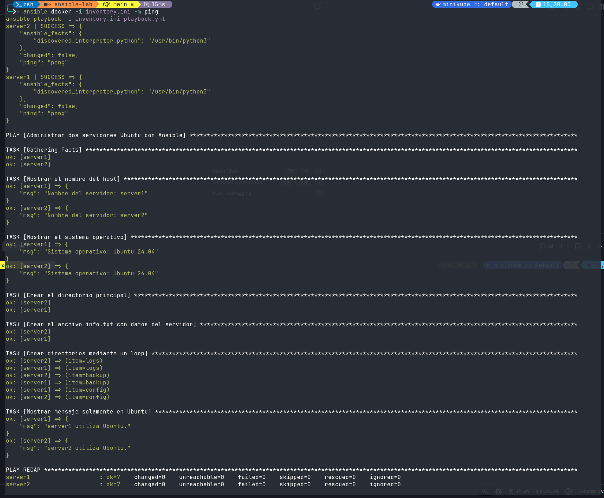

# Laboratorio de Ansible — Segundo Parcial

**Electiva 2 | ITLA**  
**Ángel González Muñoz**

## Objetivo

Administrar dos contenedores Ubuntu 24.04 con Ansible. El playbook consulta información del sistema, crea archivos y directorios, utiliza un `loop` y ejecuta una tarea condicional para Ubuntu.

## Ejecución

Requiere Docker, Docker Compose, Ansible y la colección `community.docker`.

Desde la carpeta `ansible-lab`:

```bash
docker compose up -d
docker ps

docker exec server1 bash -c 'apt-get update && apt-get install -y python3'
docker exec server2 bash -c 'apt-get update && apt-get install -y python3'

ansible-galaxy collection install community.docker
ansible docker -i inventory.ini -m ping
ansible-playbook -i inventory.ini playbook.yml
```

El resultado se guarda en `/tmp/ansible-demo` de cada contenedor, con `info.txt` y las carpetas `logs`, `backup` y `config`.

## Evidencia


